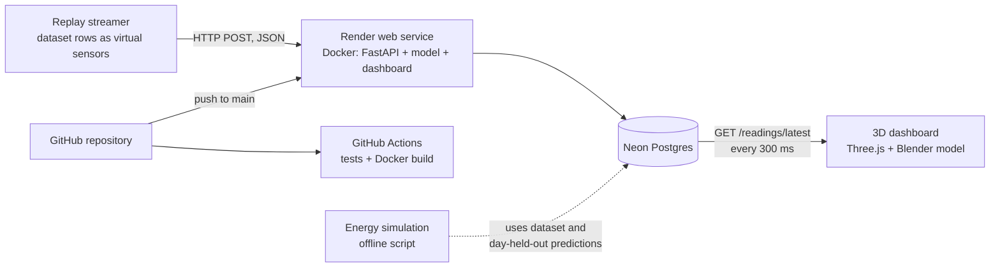

# Digital Twin for Smart Classroom Energy and Occupancy Management
 
Major Project (Phase I onward), B.Tech Computer Science and Engineering
School of Computer Science and Engineering, IILM University, Greater Noida
Session 2026-27
 
**Project ID:** PT107
**Guide:** Ms. Bhavana Shrivastava
 
## Team
 
| Name | Roll No. | Role |
|---|---|---|
| Richa Gupta | 2410031049 | Team lead, backend and integration |
| Priyanshu Kumar Tiwari | 2410031026 | ML (occupancy model) |
| Ritika Kumari | 2410031028 | 3D twin and frontend |
| Ankita Mandal | 2410031070 | Simulation and control |
 
## Overview
 
This project builds a Digital Twin of a university classroom that mirrors occupancy and environmental conditions in a virtual 3D room, and evaluates occupancy-based control of lighting and air conditioning in simulation. The application is deployed to the cloud on free tiers (Render for the container, Neon for Postgres).
 
Physical sensors are replaced by a dataset-driven virtual sensor layer. A streamer replays public dataset rows (UCI Room Occupancy Estimation) as if they were live sensor readings, and the rest of the pipeline treats them as real. All energy results come from simulation on recorded data, not from a live classroom.
 
## Current Status
 
Working: replay streamer, FastAPI backend with live occupancy prediction, SQLite (local) and Postgres (cloud) storage, Docker image, deployment on Render with a Neon database, automated API tests with a GitHub Actions workflow, a 3D dashboard that loads a Blender classroom model and updates live from the stream, and an energy simulation comparing control strategies.
 
Not done yet: hold-off and PIR-override control inside the live dashboard (the dashboard uses a simple on-when-occupied rule), a concurrent load test, shared storage for the rolling prediction history (needed to run several instances), and real sensor hardware.
 
Full measured results and their limits: [docs/test_results.md](docs/test_results.md).
 
## System Pipeline
 

 
The same backend runs locally with SQLite when no `DATABASE_URL` is set, and in the cloud with Postgres when it is.
 
## Repository Structure
 
```
smart-classroom-digital-twin-PT107/
├── .github/workflows/ci.yml   # tests and Docker build on every push
├── data/                      # raw datasets
├── streamer/                  # replay.py (virtual sensors), loadtest.py (cloud load test)
├── backend/                   # main.py: FastAPI app, database layer, live prediction
├── ml/                        # data exploration, features, training and evaluation scripts
├── twin/                      # Blender source and dashboard/ (index.html, classroom.glb)
├── simulation/                # timetable, energy simulation, results CSVs
├── tests/                     # pytest API tests
├── docs/                      # message format, assumptions, test results, screenshots
├── Dockerfile
├── requirements.txt           # full development environment
├── requirements-backend.txt   # packages needed by the container
└── README.md
```
 
## Setup
 
1. Clone the repository:
```
git clone https://github.com/richa-gupta16/smart-classroom-digital-twin-PT107.git
cd smart-classroom-digital-twin-PT107
```
 
2. Create and activate a virtual environment (Windows PowerShell):
```
python -m venv .venv
.venv\Scripts\Activate.ps1
```
On Mac/Linux use `source .venv/bin/activate`.
 
3. Install dependencies:
```
pip install -r requirements.txt
```
 
4. Make sure `data/Occupancy_Estimation.csv` is present (see Datasets below).
## How to Run
 
**Live demo locally (3D dashboard)**
 
1. Train and save the model (once):
```
python ml/save_model.py
```
2. Start the backend from the project root (SQLite database, no setup needed):
```
python -m uvicorn backend.main:app --reload
```
3. Open `http://127.0.0.1:8000/dashboard/` in a browser.
4. In a second terminal (with `.venv` active), replay one day of data (22 Dec 2017, 1,462 readings):
```
python streamer/replay.py --limit 1462 --delay 0.5 --post http://127.0.0.1:8000/readings
```
API test page: `http://127.0.0.1:8000/docs`. Health check: `http://127.0.0.1:8000/health`. For a clean demo, stop the server and delete `backend/twin.db` first.
 
**Cloud deployment**
 
The service is deployed on Render from the `Dockerfile` and connects to a Neon Postgres database through the `DATABASE_URL` environment variable.
- Live dashboard: https://smart-classroom-digital-twin-pt107.onrender.com/dashboard/
- Health check: https://smart-classroom-digital-twin-pt107.onrender.com/health
Free-tier behaviour: the service sleeps after 15 minutes without traffic and the first request afterwards is slow, so open `/health` and wait for it before replaying data. To send data to the cloud service:
```
python streamer/replay.py --limit 300 --delay 0.2 --post https://smart-classroom-digital-twin-pt107.onrender.com/readings
```
The database connection string is a secret. It is stored in Render's environment variables and in a local `.env.local` file that is excluded by `.gitignore`. Never commit it.
 
**Docker (local, optional)**
```
docker build -t classroom-twin .
docker run -p 8000:8000 -v twin-data:/data classroom-twin
```
 
**Tests**
```
python -m pytest -v
```
The GitHub Actions workflow runs the same tests and a Docker build on every push.
 
**Cloud load test**
```
python streamer/loadtest.py --url https://smart-classroom-digital-twin-pt107.onrender.com --n 200
```
 
**Model evaluation**
```
python ml/check_time.py       # date structure and gaps of the dataset
python ml/train_baseline.py   # fixed day split, PIR baseline vs. random forest
python ml/train_v2.py         # feature variants A, B, C
python ml/train_cv.py         # leave-one-occupied-day-out evaluation
```
 
**Energy simulation**
```
python simulation/timetable.py
python simulation/energy_sim.py
python simulation/plot_tradeoff.py
```
Power values and their sources are in [docs/energy_assumptions.md](docs/energy_assumptions.md).
 
## Key Results (simulation and offline evaluation)
 
Details, tables and limits are in [docs/test_results.md](docs/test_results.md).
 
- **Occupancy model (leave-one-occupied-day-out):** occupied-vs-empty recall 0.98 on 22 Dec and 23 Dec, but 0.37 on 10 Jan, so it generalizes poorly to a day recorded three weeks later.
- **Energy simulation (87.4 hours of data):** model + PIR override with a 3-minute hold-off saved 43.3% against a fixed 08:00-18:00 schedule while leaving 0.3% of occupied time without lights. PIR alone needed a 10-minute hold-off to reach the same comfort and saved 40.7%. The gain is modest and indicative, because only three days contain people.
- **Live dashboard:** update delay (server stores a reading, dashboard shows it) averaged 190 ms, maximum 479 ms over 69 readings, including a 300 ms polling interval.
- **Cloud load test (one client, sequential requests):** median latency about 200 to 285 ms per reading on Render with Neon; up to 2,000 readings sent. The 2 failed requests in the 2,000-reading run were caused by an interruption of the test machine's mobile network, not by the server. Every successful request was stored (3,198 rows in Neon after all runs).
- **Cloud limits:** the free instance has a small CPU share and sleeps when idle; the rolling prediction history is kept in memory, so a restart resets it and only one instance should run.
## Datasets and Citations
 
Both datasets come from the UCI Machine Learning Repository.
 
### 1. Room Occupancy Estimation (main dataset, used in all results)
Temperature, light, sound, CO2 and PIR readings with a ground-truth head count (0-3).
 
```bibtex
@misc{room_occupancy_estimation_864,
  author       = {Singh, Adarsh Pal and Chaudhari, Sachin},
  title        = {{Room Occupancy Estimation}},
  year         = {2018},
  howpublished = {UCI Machine Learning Repository},
  note         = {{DOI}: https://doi.org/10.24432/C5P605}
}
```
License: [CC BY 4.0](https://creativecommons.org/licenses/by/4.0/), as shown on the dataset's UCI page.
 
### 2. Occupancy Detection (downloaded, not used in the current results)
Temperature, humidity, light and CO2 readings with an occupied / not-occupied label. Files are in `data/` (`datatraining.txt`, `datatest.txt`, `datatest2.txt`).
 
Candanedo, L. (2016). *Occupancy Detection* [Dataset]. UCI Machine Learning Repository. https://doi.org/10.24432/C5X01N
 
```bibtex
@misc{occupancy_detection__357,
  author       = {Candanedo, Luis},
  title        = {{Occupancy Detection}},
  year         = {2016},
  howpublished = {UCI Machine Learning Repository},
  note         = {{DOI}: https://doi.org/10.24432/C5X01N}
}
```
License: see the license shown on the dataset's UCI page.
 
## Message Format
 
All modules exchange data in one JSON format. See [docs/message_format.md](docs/message_format.md).
 
## Project Status
 
- [x] Repository and folder structure
- [x] Dataset downloaded and explored
- [x] Message format defined
- [x] Replay streamer
- [x] Backend and database (FastAPI, live occupancy prediction, SQLite and Postgres)
- [x] Occupancy ML model (evaluated with day-based splits)
- [x] 3D twin dashboard with Blender classroom model (live updates)
- [x] Energy simulation (baselines, PIR-only, model, model + PIR, hold-off sweeps)
- [x] Docker image and cloud deployment (Render + Neon, free tiers)
- [x] Automated API tests and GitHub Actions workflow
- [x] Cloud load test (up to 2,000 readings)
- [ ] Hold-off and PIR-override control integrated into the live dashboard
- [ ] Concurrent load test
- [ ] Shared store for rolling history (to run several instances)
- [ ] Real sensor hardware (out of scope for this phase)
## Git Workflow
 
- Do not work directly on `main`. Create your own branch, for example `git checkout -b ml-work`.
- Commit small and often with clear messages.
- Run `git pull` before `git push`. Pushing to `main` triggers the CI workflow and a Render redeploy.