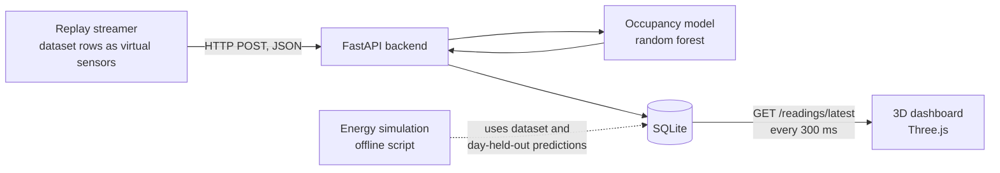

# Digital Twin for Smart Classroom Energy and Occupancy Management

Major Project (Phase I onward), B.Tech Computer Science and Engineering
School of Computer Science and Engineering, IILM University, Greater Noida
Session 2026-27

**Project ID:** PT107
**Guide:** Ms. Bhavana Shrivastava

## Team

| Name | Roll No. | Role |
|---|---|---|
| Richa Gupta | 2410031049 | Team lead, backend and integration |
| Priyanshu Kumar Tiwari | 2410031026 | ML (occupancy model) |
| Ritika Kumari | 2410031028 | 3D twin and frontend |
| Ankita Mandal | 2410031070 | Simulation and control |

## Overview

This project builds a Digital Twin of a university classroom that mirrors occupancy and environmental conditions in a virtual 3D room, and evaluates occupancy-based control of lighting and air conditioning in simulation.

Physical sensors are replaced by a dataset-driven virtual sensor layer. A streamer replays public dataset rows (UCI Room Occupancy Estimation) as if they were live sensor readings, and the rest of the pipeline treats them as real. All energy results come from simulation on recorded data, not from a live classroom.

## Current Status

Working: replay streamer, FastAPI backend with SQLite, occupancy model (random forest) used live in the backend, browser 3D dashboard (Three.js) updating from the live stream, and an energy simulation comparing control strategies.

Not done yet: Blender classroom model (the room is currently built from Three.js shapes), integration of the hold-off / PIR-override control logic into the live dashboard (the dashboard uses a simple placeholder rule), and real sensor hardware.

Full measured results and their limits: [docs/test_results.md](docs/test_results.md).

## System Pipeline



## Repository Structure

```
smart-classroom-digital-twin-PT107/
├── data/          # raw datasets
├── streamer/      # replay.py: replays dataset rows as virtual sensors
├── backend/       # main.py: FastAPI app, SQLite storage, live prediction
├── ml/            # data exploration, features, training and evaluation scripts
├── twin/          # dashboard/index.html: Three.js 3D dashboard
├── simulation/    # timetable, energy simulation, results CSVs
├── docs/          # message format, assumptions, test results, screenshots
├── requirements.txt
└── README.md
```

## Setup

1. Clone the repository:
```
git clone https://github.com/richa-gupta16/smart-classroom-digital-twin-PT107.git
cd smart-classroom-digital-twin-PT107
```

2. Create and activate a virtual environment (Windows PowerShell):
```
python -m venv .venv
.venv\Scripts\Activate.ps1
```
On Mac/Linux use `source .venv/bin/activate`.

3. Install dependencies:
```
pip install -r requirements.txt
```

4. Make sure `data/Occupancy_Estimation.csv` is present (see Datasets below).

## How to Run

**Live demo (3D dashboard)**

1. Train and save the model (once):
```
python ml/save_model.py
```
2. Start the backend from the project root:
```
python -m uvicorn backend.main:app --reload
```
3. Open `http://127.0.0.1:8000/dashboard/` in a browser.
4. In a second terminal (with `.venv` active), replay one day of data (22 Dec 2017, 1,462 readings):
```
python streamer/replay.py --limit 1462 --delay 0.5 --post http://127.0.0.1:8000/readings
```
API test page: `http://127.0.0.1:8000/docs`. For a clean demo, stop the server and delete `backend/twin.db` first.

**Model evaluation**
```
python ml/check_time.py       # date structure and gaps of the dataset
python ml/train_baseline.py   # fixed day split, PIR baseline vs. random forest
python ml/train_v2.py         # feature variants A, B, C
python ml/train_cv.py         # leave-one-occupied-day-out evaluation
```

**Energy simulation**
```
python simulation/timetable.py
python simulation/energy_sim.py
python simulation/plot_tradeoff.py
```
Power values and their sources are in [docs/energy_assumptions.md](docs/energy_assumptions.md).

## Key Results (simulation and offline evaluation)

Details, tables and limits are in [docs/test_results.md](docs/test_results.md).

- Pipeline: all 10,129 readings stored with no loss at about 34.6 readings/s; live dashboard update delay about 221 ms on average (includes a 300 ms polling interval).
- Occupancy model (leave-one-occupied-day-out): occupied-vs-empty recall 0.98 on 22 Dec and 23 Dec, but 0.37 on 10 Jan, so it generalizes poorly to a day recorded three weeks later.
- Energy simulation (87.4 hours of data): model + PIR override with a 3-minute hold-off saved 43.3% against a fixed 08:00-18:00 schedule while leaving 0.3% of occupied time without lights. PIR alone needed a 10-minute hold-off to reach the same comfort and saved 40.7%. The gain is modest and indicative, because only three days contain people.

## Datasets and Citations

Both datasets come from the UCI Machine Learning Repository.

### 1. Room Occupancy Estimation (main dataset, used in all results)
Temperature, light, sound, CO2 and PIR readings with a ground-truth head count (0-3).

```bibtex
@misc{room_occupancy_estimation_864,
  author       = {Singh, Adarsh Pal and Chaudhari, Sachin},
  title        = {{Room Occupancy Estimation}},
  year         = {2018},
  howpublished = {UCI Machine Learning Repository},
  note         = {{DOI}: https://doi.org/10.24432/C5P605}
}
```
License: [CC BY 4.0](https://creativecommons.org/licenses/by/4.0/), as shown on the dataset's UCI page.

### 2. Occupancy Detection (downloaded, not used in the current results)
Temperature, humidity, light and CO2 readings with an occupied / not-occupied label. Files are in `data/` (`datatraining.txt`, `datatest.txt`, `datatest2.txt`).

Candanedo, L. (2016). *Occupancy Detection* [Dataset]. UCI Machine Learning Repository. https://doi.org/10.24432/C5X01N

```bibtex
@misc{occupancy_detection__357,
  author       = {Candanedo, Luis},
  title        = {{Occupancy Detection}},
  year         = {2016},
  howpublished = {UCI Machine Learning Repository},
  note         = {{DOI}: https://doi.org/10.24432/C5X01N}
}
```
License: see the license shown on the dataset's UCI page.

## Message Format

All modules exchange data in one JSON format. See [docs/message_format.md](docs/message_format.md).

## Project Status

- [x] Repository and folder structure
- [x] Dataset downloaded and explored
- [x] Message format defined
- [x] Replay streamer
- [x] Backend and database (FastAPI, SQLite, live occupancy prediction)
- [x] Occupancy ML model (evaluated with day-based splits)
- [x] 3D twin dashboard (Three.js primitives, live updates)
- [x] Energy simulation (baselines, PIR-only, model, model + PIR, hold-off sweeps)
- [ ] Blender classroom model
- [ ] Hold-off and PIR-override control integrated into the live dashboard
- [ ] Real sensor hardware (out of scope for this phase)

## Git Workflow

- Do not work directly on `main`. Create your own branch, for example `git checkout -b ml-work`.
- Commit small and often with clear messages.
- Run `git pull` before `git push`.